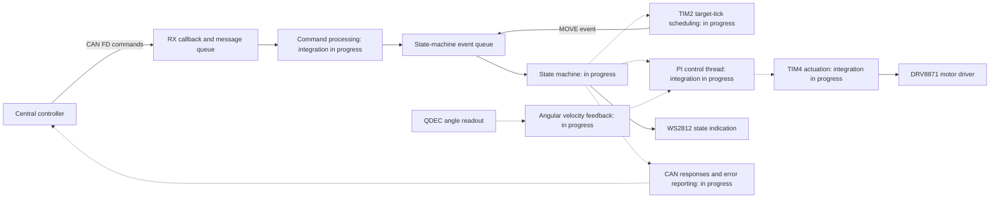
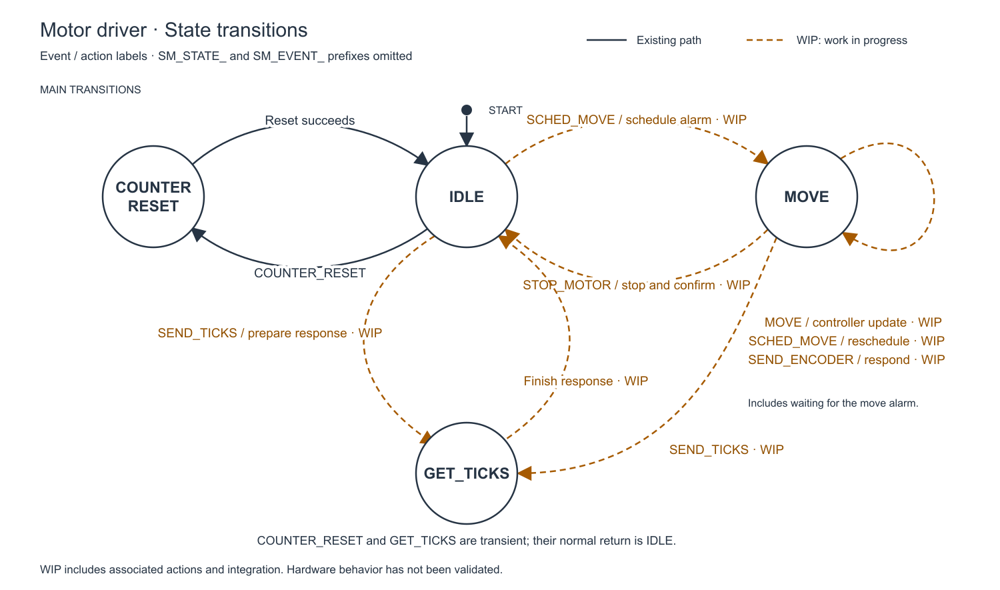

# STM32 Motor Controller — Zephyr RTOS

A motor-driver firmware project for the **STM32 Nucleo-G431KB** exploring CAN FD communication, real-time coordination, state machine implementation, and PID motor control.

**Development status: in progress.** Peripheral interfaces and event-processing code are present. CAN transmission, state-machine completion, closed-loop motor control, and fault recovery remain in progress; end-to-end hardware validation is still pending.

## Development Progress

Statuses describe implementation progress; they do not certify a passing build or hardware validation. Completed subfeatures can belong to a module whose integration remains in progress.

| Module | Status |
| --- | --- |
| CAN | :hourglass_flowing_sand: In Progress |
| | <table><thead><tr><th>Feature</th><th>Status</th></tr></thead><tbody><tr><td>CAN FD reception &amp; acceptance filtering</td><td>:white_check_mark: Completed</td></tr> <tr><td>RX message queuing &amp; retrieval</td><td>:white_check_mark: Completed</td></tr> <tr><td>Command/event integration &amp; queued payload handling</td><td>:hourglass_flowing_sand: In Progress</td></tr> <tr><td>Outgoing message queuing &amp; CAN FD transmission with BRS</td><td>:hourglass_flowing_sand: In Progress</td></tr> <tr><td>Tick responses &amp; error notifications</td><td>:hourglass_flowing_sand: In Progress</td></tr> <tr><td>Queue, mailbox &amp; worker shutdown on error</td><td>:hourglass_flowing_sand: In Progress</td></tr></tbody></table> |
| State Machine | :hourglass_flowing_sand: In Progress |
| | <table><thead><tr><th>Feature</th><th>Status</th></tr></thead><tbody><tr><td>Event queue &amp; dispatch worker</td><td>:white_check_mark: Completed</td></tr> <tr><td>Full transition matrix &amp; state entry/exit integration</td><td>:hourglass_flowing_sand: In Progress</td></tr> <tr><td>Encoder response handling</td><td>:hourglass_flowing_sand: In Progress</td></tr> <tr><td>Motor-stop confirmation</td><td>:hourglass_flowing_sand: In Progress</td></tr> <tr><td>Hardware recovery from critical error</td><td>:hourglass_flowing_sand: In Progress</td></tr> <tr><td>Error-state shutdown, event handling &amp; CAN notification</td><td>:hourglass_flowing_sand: In Progress</td></tr></tbody></table> |
| PID Controller | :hourglass_flowing_sand: In Progress |
| | <table><thead><tr><th>Feature</th><th>Status</th></tr></thead><tbody><tr><td>Dedicated high-priority thread lifecycle</td><td>:hourglass_flowing_sand: In Progress</td></tr> <tr><td>Integral windup &amp; output clamping arithmetic</td><td>:white_check_mark: Completed</td></tr> <tr><td>Encoder-derived angular velocity &amp; control timing</td><td>:hourglass_flowing_sand: In Progress</td></tr> <tr><td>PI controller integration &amp; tuning</td><td>:hourglass_flowing_sand: In Progress</td></tr> <tr><td>Derivative term</td><td>:hourglass_flowing_sand: In Progress</td></tr></tbody></table> |
| PWM Actuation | :hourglass_flowing_sand: In Progress |
| | <table><thead><tr><th>Feature</th><th>Status</th></tr></thead><tbody><tr><td>Clockwise &amp; counter-clockwise channel control</td><td>:white_check_mark: Completed</td></tr> <tr><td>Braking, stop handling &amp; controller integration</td><td>:hourglass_flowing_sand: In Progress</td></tr> <tr><td>Motor power shutdown on PWM failure</td><td>:hourglass_flowing_sand: In Progress</td></tr> <tr><td>PWM recovery/reinitialization</td><td>:hourglass_flowing_sand: In Progress</td></tr></tbody></table> |
| QDEC Readout | :hourglass_flowing_sand: In Progress |
| | <table><thead><tr><th>Feature</th><th>Status</th></tr></thead><tbody><tr><td>Angular displacement readout</td><td>:white_check_mark: Completed</td></tr> <tr><td>Velocity-feedback integration with controller</td><td>:hourglass_flowing_sand: In Progress</td></tr></tbody></table> |
| Timer & Move Scheduling | :hourglass_flowing_sand: In Progress |
| | <table><thead><tr><th>Feature</th><th>Status</th></tr></thead><tbody><tr><td>Counter readout, reset &amp; heartbeat</td><td>:white_check_mark: Completed</td></tr> <tr><td>Alarm callback posting MOVE events</td><td>:white_check_mark: Completed</td></tr> <tr><td>CAN target-tick scheduling &amp; state-machine integration</td><td>:hourglass_flowing_sand: In Progress</td></tr></tbody></table> |
| Task Watchdog & Error Recovery | :hourglass_flowing_sand: In Progress |
| | <table><thead><tr><th>Feature</th><th>Status</th></tr></thead><tbody><tr><td>Watchdog configuration &amp; controller lifecycle integration</td><td>:hourglass_flowing_sand: In Progress</td></tr> <tr><td>Callback context, timeout handling &amp; recovery</td><td>:hourglass_flowing_sand: In Progress</td></tr> <tr><td>Main-loop error reporting over CAN</td><td>:hourglass_flowing_sand: In Progress</td></tr></tbody></table> |
| State-machine Unit Tests | :hourglass_flowing_sand: In Progress |
| | <table><thead><tr><th>Feature</th><th>Status</th></tr></thead><tbody><tr><td>Tick-response test integration &amp; execution</td><td>:hourglass_flowing_sand: In Progress</td></tr> <tr><td>Transition, stop &amp; error-path coverage</td><td>:hourglass_flowing_sand: In Progress</td></tr></tbody></table> |
| WS2812 Status RGB | :white_check_mark: Completed |

The controller currently contains proportional and integral calculations; derivative support, feedback integration, and tuning remain in progress. A ztest/FFF case exercises the IDLE tick-response path with mocked dependencies. Test integration and broader coverage remain in progress; no build, test run, or hardware validation was performed for this documentation update.

## System Overview

| Area | Details |
| --- | --- |
| Platform | STM32G431KB / Nucleo-G431KB; Zephyr C application |
| Motor interface | PWM on TIM4 channels 1 and 2 controlling DRV8871 motor driver|
| Feedback | Quadrature encoder angular readout |
| Communication | CAN FD configuration: 500 kbit/s arbitration, 2 Mbit/s data |
| Coordination | Queued state-machine events and motor alarms |
| Observability | Zephyr logging, heartbeat GPIO for timer and WS2812 status pixel for state-machine |
| Unit testing | ztest/FFF tick-response test targeting QEMU Cortex-M3; integration and broader transition coverage in progress |
| Debugging | Zephyr logging, OpenOCD + GDB, DMM, Oscilloscope |

## Architecture



The diagram shows the intended system flow; dashed connections identify integration that remains in progress. Received CAN frames pass through an RX queue and command-processing worker toward the state-machine event queue. Command payload handling and complete state/event behavior remain in progress.

TIM2 provides counter readout and heartbeat support, with an alarm callback that posts MOVE events. Scheduling against the CAN-supplied target ticks remains in progress. The controller thread contains calls for QDEC polling, PI calculations, and PWM actuation; angular-velocity feedback, timing, thread lifecycle, and closed-loop integration remain in progress. Outgoing CAN responses, motor-stop handling, watchdog integration, and fault recovery also remain in progress.

## State transitions

The diagram follows the main paths in the current state-machine implementation. State names omit the `SM_STATE_` prefix, and event labels omit `SM_EVENT_`. **WIP = work in progress**: the transition or its associated action still needs implementation or integration. Unmarked paths describe existing code, not verified hardware behavior. Ignored events are omitted for readability.



[Open the scalable SVG figure](docs/images/state-transitions.svg).

COUNTER_RESET and GET_TICKS perform their actions within event handling and normally return to IDLE. The current tick-response path returns to IDLE even when requested from MOVE; response integration remains WIP.

## Hardware configuration

| Peripheral | Pins / configuration |
| --- | --- |
| TIM4 PWM | PB6 / channel 1, PB7 / channel 2; pull-ups, inverted polarity in code |
| TIM3 encoder | PA6 / channel 1, PA7 / channel 2; mode 3; 2448 counts/revolution |
| CAN FD | PA11 RX, PA12 TX; external transceiver and suitable bus termination required |
| TIM2 heartbeat | PA4 GPIO; intended 1 s toggle interval |
| SPI WS2812 | PB3 SCK, PB5 MOSI; one pixel, state colors at 10% brightness |

The encoder's configurations are set to 12 pulses/revolution, a 51:1 gear ratio, and quadrature x4 counting. 

## CAN command format

Incoming commands use 11 logical payload bytes in a **12-byte CAN FD frame**. Outgoing response integration remains in progress:

| Byte offset | Width | Meaning |
| --- | --- | --- |
| 0 | 1 | Payload target: local ID `0x65` or broadcast `0xFF` |
| 1–2 | 2 | Action characters |
| 3–6 | 4 | Action data; move uses big-endian float bits for rad/s |
| 7–10 | 4 | Big-endian target counter ticks |
| 11 | 1 | Padding for DLC of 9 = 12 bytes |

## Repository map

```text
src/
  main.c                 Component initialization; error reporting/recovery in progress
  CAN/                   RX callbacks and queues; command integration and TX in progress
  STATE_MACHINE/         Event dispatch; transitions, control and error handling in progress
  PID/                   Fixed-point PI arithmetic; integration and derivative work in progress
  PWM/                   Motor-output mapping; stop/fault handling and integration in progress
  QDEC/                  Encoder angle API; velocity-feedback integration in progress
  TIMER/                 TIM2 ticks and heartbeat; target-tick scheduling in progress
  STAT_RGB/              State-to-color indication via WS2812
  TASK_WATCHDOG/         Software watchdog/controller integration in progress
  DRIVER_CONFIG/         CAN and controller constants
  UART/                  Experimental interface, excluded from build
  PD_CONTROLLER/         Earlier experiment, excluded from build
  Depracated/QDEC/        Earlier counter-based encoder experiment, excluded from build
unit-tests/state_machine/  ztest/FFF tick-response test; integration and coverage in progress
```
